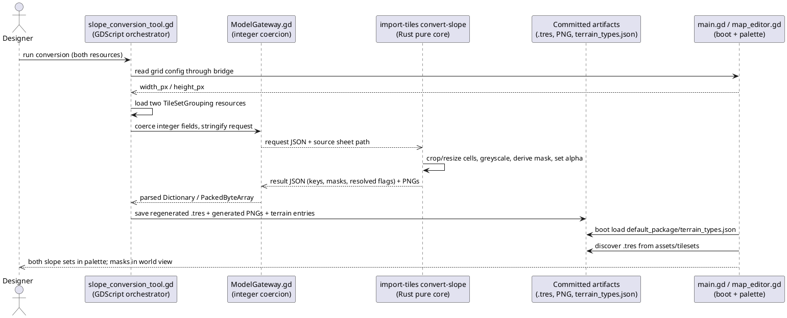

# Plan: convert both 30-degree grass slope resources into world tile sets (#178)

Ticket: [#178](https://github.com/HidekiAI/sidescroll-towerdefense/issues/178) --
`feat(editor): convert both grass slope resources into world tile sets`.

Design of record: wiki [TDD_Tile-Art-Pipeline](https://github.com/HidekiAI/sidescroll-towerdefense/wiki/TechnicalDesign/TDD_Tile-Art-Pipeline),
[TDD_Tile-Sub-Tile-Resolution](https://github.com/HidekiAI/sidescroll-towerdefense/wiki/TechnicalDesign/TDD_Tile-Sub-Tile-Resolution),
and the #126 lineage in [TDD_Collision-Map-Tooling](https://github.com/HidekiAI/sidescroll-towerdefense/wiki/TechnicalDesign/TDD_Collision-Map-Tooling)
(ART -> DATA -> TECH). This document is a plan only. It adds no implementation code.

Label convention: a repository fact is written as MEASURED with the command or `file:line`
that produced it, or as UNVERIFIED with what S1 must measure. A proposed design choice is
written as PLANNED and is not a claim about the current repository. This convention applies
outside the Premises block too, so a fact does not become true by moving three sections down.

## Objective and story

The ticket's story is at lines 9-11: a level designer needs BOTH grass slope resources converted
into world tile sets with collision alpha, so placed slopes have art and ground contact in
agreement. The deliverable is a repeatable conversion command plus committed default-terrain
artifacts for the right and left resources. Ticket lines 57-69 add the upstream two-phase
source-art preprocessing that feeds that conversion; the plan covers both below.

## Resolved open question (ticket lines 53 and 55)

Ticket line 53 asks whether "default terrain for distributions" means the committed
`editor/default_package/` or the user-data world bundle. CONFIRMED BY @me in the 2026-11-25
planning session (the ticket export has no comment): the committed `editor/default_package/`,
together with the committed built-in tile catalog in `editor/assets/tiles/` and the committed
authoring resources in `editor/assets/tilesets/`. That answer is the decision of record and is
written here and in ticket line 55.

Why the committed package is the workable target, all MEASURED: `editor/scripts/main.gd:155-157`
loads framework defaults from `res://default_package/terrain_types.json` and
`res://default_package/entity_defs.json` on every boot; `editor/scripts/map_editor.gd:464-481`
discovers committed `.tres` files under `res://assets/tilesets`;
`editor/scripts/map_editor.gd:267-270` and `:272-309` rebuild the terrain-default grouping
entries that `editor/scripts/tile_palette.gd:44-70` renders. A user-data `.zip` can override
visuals (`editor/scripts/world_archive.gd:11-23`), but a fresh distribution cannot depend on
one. PLANNED reading of ticket line 26: "world bundle" means the shipped distribution payload,
not `user://data/world.zip`; this matches @me's answer above.

## Provenance (MEASURED; gathered by the planner and handed to the evaluator)

Blame was run per source class with `git blame --date=short -L <range> -- <file>`; each
distinct blamed commit was resolved with `git show -s --format='%h|%ad|%an|%s' --date=short`.
Every blamed author is `Hideki A. Ikeda`; the full output is
`/tmp/user/1000/opencode/sstd-plan-provenance-detail.md`.

| Source class (file:lines) | Blamed commits (hash / date / subject) |
| --- | --- |
| Slope side note and planning scope — `AGENTS.md:1041-1076` | `39a977d` 2026-11-25 scope planning to data paths; `888a3c9` 2026-11-25 gate behind passing plan; `a20ed9f` 2026-11-24 ground-profile snapshot (#161); `ba862dc` 2026-11-24 side note; `be48c36` 2026-11-25 link to #178 |
| Right and left authoring resources — `editor/assets/tilesets/slope_grass_30deg_4x2.tres:1-30`, `..._left.tres:1-30` | `904467f` 2026-08-03 editor node/container fix (#33) |
| `TileSetGrouping.resolve()` — `editor/scripts/resources/tile_set_grouping.gd:3-40` | `904467f` 2026-08-03 (#33) |
| Boot grid config — `editor/scripts/main.gd:150-157` | `1466a7a` 2026-08-01 screen registry (#1); `3b5d1e3` 2026-08-26 res:// fix (#63); `829e8fe` 2026-07-21 editors 2-4 |
| Terrain mask injection — `editor/scripts/main.gd:261-272` | `2e37f05` 2026-11-23 wire masks to world view (#126) |
| Palette population — `editor/scripts/map_editor.gd:267-270` | `800caff` 2026-08-13 tile palette picker (#49) |
| Tile lookup and tileset discovery — `editor/scripts/map_editor.gd:321-340`, `:464-481` | `ae28994` 2026-08-18 move writes to `user://` (#54 M1); `d03023e` 2026-08-09 world archive (#43); `af7beeb` 2026-07-31 tab pre-instance |
| Terrain schema — `crates/sstd-core/src/terrain.rs:160-198`, `:205-252` | `a42d32f` 2026-11-20 solid_mask schema (#126); `b020b86` 2026-08-28 sub_tile_mask float fix; `b709026` 2026-11-16 TODO scaffold; `904467f` 2026-08-03; `d9b26e2` 2026-07-21 initial model |
| Mask stages — `tools/import-tiles/src/main.rs:13-28`, `:483-674` | `984dd76` 2026-11-18 named luma weights (#126); `a021f04` 2026-11-18 tests and scaffolds; `45ffd6f` 2026-11-19 per-pixel mask pipeline (#126) |
| Integer coercion seam — `editor/scripts/model_gateway.gd:110-125` | `0531ec8` 2026-11-25 Rust bridge model gateway |
| Committed default terrain — `editor/default_package/terrain_types.json:1-40` | `9d78881` 2026-08-27 entity/terrain def overrides (#67) |

PR search (MEASURED negative result; every command and its RAW output are in
`/tmp/user/1000/opencode/sstd-pr-search-evidence.md`, generated by
`/tmp/user/1000/opencode/sstd-pr-evidence.sh`): `gh api repos/HidekiAI/sidescroll-towerdefense/commits/<sha>/pulls`
was run for all 23 blamed commits. 21 pushed commits returned `[]`; the two local-only planning
commits `39a977d` and `888a3c9` returned HTTP 422 ("No commit found for SHA"), so they have no
remote PR by definition. `gh pr list --repo HidekiAI/sidescroll-towerdefense --search slope
--state all` and the same with `--search tileset` both returned `[]`. Every number in the blamed
commit subjects was checked with `gh api repos/HidekiAI/sidescroll-towerdefense/issues/<n> --jq
'{number,title,state,is_pull_request:(.pull_request != null)}'`: #1, #33, #43, #49, #54, #63,
#67, #126, #161 and #178 (the ticket under gate) each returned `"is_pull_request":false`, so
those are GitHub ISSUES, not PRs.
Therefore THERE ARE NO PR REVIEW THREADS OR REVIEW DECISIONS TO CITE for any changed line; that
is the measured outcome of the searches, not a source that was skipped. The issue bodies and
comments themselves are in `/tmp/user/1000/opencode/sstd-pr-provenance.md`.

Related tickets and their decision comments (MEASURED; same export):

- #126 (continuous ground_y / collision surface): the 2026-11-15 comment made per-pixel alpha
  the detector and chose the art pipeline; the 2026-11-16 comment SUPERSEDES it with greyscale
  as detector and alpha as product (ticket line 19 here follows that later decision); the
  2026-11-17 comment orders resolution as bottom-row anchor, patch sample, 4-connectivity,
  majority, with the red border as last resort; the 2026-11-24 closing comment records a
  0.00 px PNG sweep over 224 columns and files #147 (stale terrain count) and #148 (PNG
  decode trap).
- #142 (tile-scan to `terrain_types.json` test gap): records that the literal `solid_mask`
  key needs a test. This plan's registration unit test closes that gap for generated entries.
- #149 / #161 (Rust model migration): #149 carries the `JSON.stringify` -> `15.0` / serde
  `u8` trap as a design constraint, which is why this plan has both request coercion and
  canonical re-save guards; #161 added the ground-profile snapshot AC4's consumer uses.
- #168 (plateau hold alignment): context for why walker contact is measured against the
  drawn art rather than a hand-drawn polygon.

Design pages searched: TDD_Tile-Art-Pipeline, TDD_Tile-Sub-Tile-Resolution,
TDD_Collision-Map-Tooling, TDD_Simulator-Ground-Walk section 7, TDD_Physics "Ground Contact
and Friction Gliding", and PostMortem/Slope-Hopping-2026-11-10.

Source classes NOT searched, named explicitly per the gate: GitHub Discussions for this
repository, wiki page revision history/blame, and any Jira or Confluence mirror (no such
tracker is configured for this personal repository). No finding in this plan depends on
those three classes.

## Traceability matrix (ticket line -> plan section -> guard)

| Ticket line | Requirement | Plan section | Guard |
| --- | --- | --- | --- |
| 7, 9-11 | TL;DR and designer story | Objective and story | Acceptance review |
| 13-19 | Two authoring resources; simulator loads neither; greyscale is detector, alpha is product | Premises, Technical design | Source-resolution step, alpha unit test |
| 21-26 | Five approach steps | Pipeline stages | Implementation steps S1-S6 |
| 28 | Difficulty L; ledger S0, S7, S8 (gate, full verification, issue close) | Step ledger (9 implementation steps), STEP LEDGER | Gate; reverse trace anchors each step to L28, L32-L38 and L67-L69 |
| 30-32 AC1 | Both slope sets in palette | Palette and default-terrain registration | Headless editor palette test |
| 30-33 AC2 | Every generated tile exactly configured W x H | Request contract, generated images | Unit test on emitted PNG dimensions |
| 30-34 AC3 | Each alpha pixel solid exactly where greyscale is ground | Alpha derivation | Unit test, pixel-by-pixel oracle |
| 30-35 AC4 | Walker contact on drawn edge within 1 px | Runtime consumption | Headless walker test |
| 30-36 AC5 | Fresh editor loads them with no local import | Resolved open question, artifacts | Fresh-profile boot test |
| 30-37 AC6 | Two runs give identical tile pixels | Determinism | Byte-compare test |
| 30-38 AC7 | Unresolvable tile flagged, no guessed collision | Resolution and flag | Unresolved-fixture test |
| 40-43 | Nice-to-have tests | Test plan | Unit + headless E2E layers |
| 30-32, 30-36, 40-43 | Idempotent publication and repeated full run | Runtime consumption, Test plan | Full-pipeline repeat and keyed-upsert guards |
| 21-26, 51-53 | Provenance of authoring resources and open-question decision | Provenance | Blame table plus measured PR-search negative result |
| 30-32, 30-37 | Registration and repeat merge of all 16 generated keys | Data structures, Test plan | Registration unit test and second-full-run guard |
| 30-38, planning-scope note | Both transformation directions | Ownership and transformation directions | Request-coercion and canonical re-save guards |
| 30-35 | AC4 unmet keeps the ticket open | Step S6, Step S8 | STOP condition and close condition |
| 45-49 | Out of scope | Out of scope | Ledger rule 6 |
| 51-53 | Open question | Resolved open question above | Fresh-profile headless guard |
| 55 | Answer now recorded in the ticket | Resolved open question above | Read-back of the ticket body |
| 57-65 | Two-phase preprocessing source, steps and reuse | Two-phase source-art preprocessing | Crop, grid-line, slice, sign-off and sidecar guards |
| 67-69 | AC8-AC10 for the preprocessing phases | Two-phase source-art preprocessing and Test plan | Named unit guards |
| 73-75 | Nice-to-have preprocessing tests | Test plan | Mutation battery |

### Reverse trace: every plan item -> exact ticket sentence

An item with no anchor here is out of scope, whatever its forward section says (shared lesson
`01M874FTHNXTP6J0PJCS7RNPJ8`). "L" is the ticket line in `/tmp/user/1000/opencode/sstd-issue-178.md`.

| Plan item | Ticket anchor (exact sentence or quoted clause) |
| --- | --- |
| Objective and story | L11 "As a level designer, I need the right and left grass slope resources converted into world tile sets with collision alpha, so that I can place both slopes and have their art and ground contact agree." |
| Resolved open question and committed-package destination | L26 "Save the converted tile sets as default terrain in a world bundle."; L53 "@HidekiAI Does \"default terrain for distributions\" mean the committed default package or the user-data world bundle?" (answer confirmed by @me, recorded above) |
| Provenance section | L17 "The request was recorded on 2026-11-24 in the code repo's `AGENTS.md` side note (commit `ba862dc`) while the Rust model migration was in flight." |
| Premises: two authoring resources | L15 "The editor has two grass slope resources: right and left. They are authoring records. The simulator does not load either one." |
| Premises: greyscale is input, alpha is product | L19 "The collision silhouette therefore has to be derived from greyscale. Alpha is the generated product, not the input." |
| Configured W/H, request and result JSON, crop / resize / flip stages | L22 "Expand each resource into grid cells and tile images at the configured tile width and height in pixels." |
| Greyscale detection, patch sampling, speck clean, mask derivation | L23 "Derive each tile's air and ground silhouette from greyscale." |
| Alpha overlay and regenerated `.tres` | L24 "Generate collision alpha from that silhouette and overlay it on the regenerated resources." |
| Both resources, generated key form, separate right and left sets | L25 "Run the conversion for both the right and left resource."; L32 "then a right slope tile set and a left slope tile set appear in the editor tile set palette." |
| Terrain entries, keyed upsert, `sub_tile_mask` omission, canonical re-save | L26 "Save the converted tile sets as default terrain in a world bundle." |
| Multi-actor flow, ownership table, proof-of-concept skeleton | L21 "Approach:" together with L22-L26 |
| Determinism, journal logs, no partial publish, refusal behavior | L37 "then both runs produce identical tile pixel data."; L38 "then the tool flags that tile for hand editing and does not guess a collision value." |
| Configured size versus fixed 32px loader convention | L33 "then every generated tile image has exactly that width and height." |
| Palette registration and fresh-profile artifacts | L32 and L36 "then the tile set loads as default terrain without a local import." |
| Runtime consumption unchanged | L35 "then the walker's contact point is on the drawn art edge within 1 pixel." |
| Out-of-scope list | L47 art seams; L48 "Collision bounds and graduated fall damage."; L49 "Marching Squares and RDP contour simplification." |
| Standing constraints and step ledger's gate discipline | L28 "Difficulty: L"; they constrain execution and add no deliverable |
| Forward traceability matrix | L32-L38 and L67-L69 (the ten acceptance criteria) |
| Step S0 plan gate | L28 "Difficulty: L" and L32-L38 plus L67-L69 (all ACs must be verified before code) |
| Step S1 measure sources and config | L22 configured W/H; L15 two resources |
| Step S2 RED tests first | L42 "A unit test for each pipeline stage on one slope tile."; L43 "A headless editor test that both converted tile sets load from the distribution bundle." |
| Step S3 Rust conversion subcommand | L22-L24 (the first three approach steps) |
| Step S4 GDScript orchestrator and both bridge directions | L21 "Approach:" and L25 "Run the conversion for both the right and left resource." |
| Step S5 artifacts and palette registration | L26 and L32 |
| Step S6 headless guards and AC4 close condition | L32-L38, L67-L69 and L42-L43 |
| Step S7 full gate and mutation battery | L32-L38 and L67-L69 (each AC must be shown green) |
| Step S8 docs, issue close, checkpoint | L17 (ticket provenance) and L32-L38 plus L67-L69 (close only when all ACs pass) |
| `## Plan gate` record | L28 "Difficulty: L" (a large change is gated before code) |
| `conversion_expands_all_cells_at_configured_size` | L33 "then every generated tile image has exactly that width and height."; L22 |
| `alpha_matches_greyscale_mask_per_pixel` | L34 "then each alpha pixel is solid exactly where the tile's greyscale silhouette is ground." |
| `derive_mask_flags_unresolved_without_emitting_collision` | L38 "then the tool flags that tile for hand editing and does not guess a collision value." |
| `two_conversion_runs_are_byte_identical` | L37 "then both runs produce identical tile pixel data." |
| `conversion_request_coerces_integer_fields` | L22 "at the configured tile width and height in pixels." |
| `both_slope_sets_appear_in_palette` | L32 "then a right slope tile set and a left slope tile set appear in the editor tile set palette." |
| `fresh_profile_loads_default_terrain_without_import` | L36 "then the tile set loads as default terrain without a local import." |
| `walker_contact_tracks_drawn_edge_within_one_pixel` | L35 "then the walker's contact point is on the drawn art edge within 1 pixel." |
| `terrain_entries_register_all_sixteen_generated_keys` | L32 "then a right slope tile set and a left slope tile set appear in the editor tile set palette."; L26 |
| `terrain_merge_upserts_existing_keys_without_duplication` | L37 "when conversion runs twice, then both runs produce identical tile pixel data."; L26 |
| `terrain_json_resaves_integral_float_as_integer` | Lesson-driven guard `01M78GC563G13ZCHP5VXAHGHSW`, NOT a ticket deliverable: it protects L22's configured-size data bridge and L26's save-as-default-terrain write from the known `JSON.stringify` / serde trap; kept as a guard, not claimed as ticket scope |
| `second_full_conversion_run_is_byte_identical` | L37 "then both runs produce identical tile pixel data." |
| Resolved answer now in the ticket | L55 "@me chose the committed `editor/default_package/` ... NOT the user-data world bundle." |
| Two-phase source-art preprocessing section | L57 "Two-phase source-art preprocessing (added 2026-11-26)"; L59 "The source sheet is `editor/assets/samples/tileset_2-2.png` (707x388)." and "`editor/assets/auto_sets/*.png` is not the slope art."; L61 "At 32x32 the eight cells assemble into a 128x64 cleaned PNG."; L63 "Phase II runs only after human sign-off."; L65 "This preprocessing reuses `derive_solid_mask` and `flag_unresolved` from `tools/import-tiles` ..." |
| Phase I whole-grid crop and per-cell slice contract | L61 "crops one rectangle that encloses the whole grid ... then splits that cleaned rectangle into the eight cells at the measured pitch and resizes each cell to the configured tile width and height in pixels." |
| Human sign-off gate before metadata | L61 "saves the cleaned PNG for a human to repair and sign off."; L63 "Phase II runs only after human sign-off."; L68 "phase II refuses to emit metadata until a human repairs and signs off." |
| JSONC sidecar contract | L63 "It emits a JSONC sidecar describing each tile's source row and column, pixel rectangle, dimensions and mask encoding."; L69 "then a JSONC sidecar records each tile's row, column, pixel rectangle, dimensions and mask encoding" |
| `preprocess_crops_whole_grid_then_slices_eight_cells` | L67 "the cleaned PNG contains eight cells of exactly the configured tile size, assembled at 4 columns by 2 rows (128x64 at 32x32)"; L73 "A unit test that moves the crop origin and reddens the crop-bounds guard." |
| `preprocess_clears_every_grid_line_pixel` | L67 "with every grid-line pixel at alpha `0x00`."; L74 "A unit test that leaves one grid-line pixel opaque and reddens the grid-line alpha guard." |
| `preprocess_flags_unresolved_and_blocks_phase_ii` | L68 "then that cell is flagged, no collision value is invented, and phase II refuses to emit metadata until a human repairs and signs off." |
| `jsonc_sidecar_round_trips_after_human_signoff` | L69 "Rust reads the PNG plus sidecar without re-deriving tile positions."; L75 "A headless guard that a human-repaired cleaned PNG and its JSONC sidecar round-trip into Rust without re-deriving cell positions." |
| PNG decode layer named for Rust and GDScript | L65 "Decode the PNG file itself with `Image.new().load(path)`, never `(load(path) as CompressedTexture2D).get_image()`"; the Rust-owned equivalent `image::open(path)` is a file decode, not an imported texture |
| Per-cell mask dimension resolved | L61 "Phase I then guesses the air mask at the same dimensions as the alpha channel"; resolved as each resized cell's W x H, not the whole-grid 4W x 2H sheet |
| Sixteen RED tests named in the ledger | L42-L43 (the original twelve), L73-L75 (the three nice-to-have preprocessing tests) and L68 (AC9, the fourth guard `preprocess_flags_unresolved_and_blocks_phase_ii`) |
| Named mask literals in Rust assisted samples | Lesson-driven guard `01M7QGRZ6X0NBYF41TW9VNGMAG`, not a new ticket deliverable: the `0x00`, `0x80` and `0xFF` mask encodings named at their use |
| Race / repeat / non-determinism disposition and layer per test | L37 and L38; L42-L43 (unit versus headless editor layers) |

## Premises: MEASURED versus UNVERIFIED

Every premise used below is labelled. A premise not backed by a command or a `file:line` is not
treated as fact by an implementation step.

MEASURED:

- Current branch is `local/docs/plan-slope-conversion-tool`; the plan file does not exist before
  this write (`git branch --show-current`, `test -e`).
- The two committed authoring resources are `editor/assets/tilesets/slope_grass_30deg_4x2.tres`
  and `editor/assets/tilesets/slope_grass_30deg_4x2_left.tres`. Each has 8 entries; right source
  keys are `slope_30deg_{0,1,2,3}_{0,1}` and left keys are the same set in reversed column order
  with `flip_h: true` on every entry (`.tres:7-14`, entries from `:15`).
- Grid geometry in both resources: `src_margins = Vector2i(104, 65)`, `src_cell_size =
  Vector2i(126, 126)`, `src_separation = Vector2i(1, 1)`, source sheet
  `res://assets/samples/tileset_2-2.png` (`.tres:11-14`). Pitch is therefore 127 px in each axis.
- `TileSetGrouping` owns the authoring fields and `resolve()` (`tile_set_grouping.gd:3-12`,
  `:15-40`). The `.tres` files are discovered from `res://assets/tilesets`
  (`map_editor.gd:464-481`); the palette is populated by `map_editor.gd:267-270` via
  `tile_palette.gd:44-70`.
- Runtime tile-image lookup uses `res://assets/tiles/{key}_32x32.png` (`map_editor.gd:321-340`,
  `world_view_ground.gd:42-47`); `map_editor.gd:38` declares `const STAMP_CELL := 32`.
- Config keys and defaults are `grid.tile_width_in_pixels` / `grid.tile_height_in_pixels`, both
  seeded as `"32"` (`config.rs:89-90`, `:395-412`); the bridge exposes the grid config as JSON at
  `sstd-editor-bridge/src/lib.rs:390-400`, read by `main.gd:150-153`.
- `TerrainTypeDef` is `#[serde(deny_unknown_fields)]` and owns `solid_mask: Vec<u8>` with a serde
  default (`crates/sstd-core/src/terrain.rs:160-184`). Empty means "not scanned"; the documented
  fallback is whole-tile solid (`:181-182`).
- `tools/import-tiles/src/main.rs` already has `to_greyscale` (`:483`), `uniform_patch_grey`
  (`:498`), `remove_floating_specks`, `derive_solid_mask` (`:568-625`, returning
  `(packed_mask, resolved)`), `flag_unresolved` (`:630-643`, red 1px border), and
  `terrain_entry_from_image` (`:648-674`). Its deps are `image 0.25`, `serde`, `serde_json`
  (`tools/import-tiles/Cargo.toml:6-9`), so a new subcommand needs no new dependency.
- `DEFAULT_MIN_CLUSTER_GAP` is 32 and `PATCH_SIZE_PX` is 4 (`tools/import-tiles/src/main.rs:13`,
  `:17`); luma weights are named at `:26-28`.
- `TerrainTypeDef::sub_tile_mask` has a serde default supplied by `default_sub_tile_mask()`
  (`crates/sstd-core/src/terrain.rs:176-179`, `:196-198`), and the integral-float-tolerant reader
  `deserialize_sub_tile_mask` already exists at `:205-252`. The default is a hex literal in Rust,
  not a persisted token spelled in this plan, so generated entries omit the field rather than
  introduce a new `15` literal.
- `editor/default_package/terrain_types.json` has 14 entries; 7 (`slope_up_0..6`) carry a
  128-byte `solid_mask`; `editor/scripts/main.gd:261-272` feeds those masks to the world view via
  `set_terrain_masks`.
- The 7 committed `slope_up_*` art greys are air 0 / ground 155, with the measured counts and
  bottom-row anchor recorded in the project `AGENTS.md`; the #126 ground profile consumes the
  same bit-packed mask format.
- PNG decode trap: use `Image.new().load(path)` on the PNG FILE, not
  `(load(path) as CompressedTexture2D).get_image()`; shared lesson
  `01M85D7FS36ZSVZB20AMH53PCX`. Keep it in the headless oracle.
- GDScript integer coercion trap: `JSON.stringify` emits `15.0` for integer Variants and serde
  rejects that for `u8`/`i32`; shared lesson `01M78GC563G13ZCHP5VXAHGHSW`. Timing uses
  `Time.get_ticks_msec()`, not `OS.get_ticks_msec()`.

UNVERIFIED (must be measured by step S1 before any implementation step builds on it):

- Whether all 16 generated cells resolve at `DEFAULT_MIN_CLUSTER_GAP = 32`. The source family has
  53 greys with a mixed bottom row in at least one cell (`PLAN-2026-11-12-ground-profile.md:73`,
  `:108-109`), so a cell can be flagged. This is load-bearing for AC1/AC5 and is not guessed here.
- The actual seeded config DB on this host; only the code defaults were read. S1 reads the value
  through the bridge and records it.
- Whether regenerated key prefixes (`slope_grass_30deg_4x2_r*`, `..._l*`) collide with any of the
  956 committed files in `editor/assets/tiles/`. S1 greps before emitting.
- Whether `ResourceSaver.save()` on a regenerated `.tres` preserves the authoring grid fields
  byte-for-byte apart from `tiles[]`; S2 verifies by diff.

## Technical design

### Multi-actor flow



### Ownership and transformation directions

Every cited seam in the table below is MEASURED at that `file:line`; a path that does not exist
yet is PLANNED and is named as a new file. The PlantUML actors are PLANNED components, not a claim
about current classes.

| Responsibility | Owner | Concrete seam |
| --- | --- | --- |
| Read grid W/H, load `.tres`, build request | GDScript orchestrator `editor/scripts/slope_conversion_tool.gd` | `main.gd:150-153`, `tile_set_grouping.gd:3-12` |
| Coerce integers, serialize request, parse result | `editor/scripts/model_gateway.gd` DAO | existing `JSON.stringify` helper; lesson `01M78GC563G13ZCHP5VXAHGHSW` |
| Crop, resize, greyscale, mask, alpha, determinism | Rust `tools/import-tiles` subcommand `convert-slope` | reuse `to_greyscale`, `derive_solid_mask`, `flag_unresolved` |
| Save regenerated `.tres`, merge terrain JSON | GDScript orchestrator | `ResourceSaver.save`, `main.gd:155-157` schema |
| Palette / runtime consumption | Existing editor code, unchanged | `map_editor.gd:267-270`, `:464-481`, `main.gd:261-272` |

Godot 4 -> Rust: a request JSON file (UTF-8, versioned) carrying source sheet path, margins,
cell size, separation, cols/rows, per-cell `local_x`, `local_y`, `source_col`, `source_row`,
`flip_h`, configured `width_px` / `height_px`, and output directory. All numeric fields are
coerced to `int` in GDScript before `JSON.stringify`; the Rust side deserializes with the existing
`serde` dependency. The request is a temp artifact under `user://data/tools/`; it is not committed.

Rust -> Godot: generated PNG files plus a result JSON carrying, for each cell, the generated
`terrain_key`, the packed `solid_mask` as an array of byte numbers, and a boolean `resolved`.
GDScript converts arrays to `PackedByteArray`, writes the regenerated `.tres`, and merges the
resolved entries into the committed `editor/default_package/terrain_types.json`. Numeric fields in
that JSON are integral by construction (Rust `u8`/`i32`/`bool`), so no `15.0` reaches serde.

### Data structures and file formats

```text
ConversionRequest {
    version: String,            // persisted token, named once in Rust and pinned by one test
    source_image: String,       // res://assets/samples/tileset_2-2.png
    margins_px: {x: i32, y: i32},
    cell_size_px: {x: i32, y: i32},
    separation_px: {x: i32, y: i32},
    width_px: i32, height_px: i32,   // from grid.* config
    cells: [ {
        local_x: i32, local_y: i32,
        source_col: i32, source_row: i32,
        flip_h: bool,
        generated_key: String
    } ]
}

ConversionResult {
    version: String,
    outputs: [ {
        generated_key: String,
        image_path: String,
        solid_mask: [u8],       // (width_px * height_px + 7) / 8 bytes
        resolved: bool
    } ]
}
```

Generated key form: `slope_grass_30deg_4x2_r{index}` for the right resource and
`slope_grass_30deg_4x2_l{index}` for the left, where `index = local_y * 4 + local_x` (0..7,
derived from the MEASURED 4x2 grid). The suffixes `_r` and `_l` are named constants in the tool;
the pin test asserts their on-disk spelling once. Generated images go to
`editor/assets/tiles/{generated_key}_{width_px}x{height_px}.png` with `.import` files created by
the standard Godot import path. Regenerated resources are the two existing committed `.tres`
paths, overwritten in place with their `tiles[].terrain_key` values rewritten to the generated
keys. Source cell PNGs (`slope_30deg_*_32x32.png`) are never overwritten: the generated keys are
new, so both slope sets coexist with the old source art.

Terrain entries are MERGED into `editor/default_package/terrain_types.json` under the same
`tiles` array with `is_walkable: true`, the derived `solid_mask`, and NO `sub_tile_mask`
literal: the field is omitted and the named `default_sub_tile_mask()`
(`crates/sstd-core/src/terrain.rs:196-198`) supplies its value on read. The 14 existing
entries stay; the expected result is 30 entries once all 16 cells resolve. The merge is a
PLANNED KEYED UPSERT: an entry whose `key` matches a generated key is replaced in place, a
new key is inserted, and nothing is appended twice. Entries are sorted by `key` before
serialization so output is stable across runs. The merged JSON is read back with the
integral-float-tolerant `deserialize_sub_tile_mask`
(`crates/sstd-core/src/terrain.rs:205-252`, already pinned by the existing
`type_def_deserializes_integral_float_sub_tile_mask` test at `:864`) and re-saved with
integer fields, so an already-polluted committed JSON is repaired on the first conversion
rather than rejected (lesson `01M78GC563G13ZCHP5VXAHGHSW`).

### Algorithms and complexity

1. Expand: for each cell, source rect is
   `x = margins.x + col * (cell_w + sep_x)`, `y = margins.y + row * (cell_h + sep_y)`, `w =
   cell_w`, `h = cell_h` (the same mapping as `tile_set_grouping.gd:15-23`). Resize the crop to
   `width_px x height_px` with nearest-neighbour, matching the deleted extractor documented in
   the project `AGENTS.md`. For left entries, flip horizontally AFTER resize, so the detector
   sees the final art. Cost O(16 * W * H); at W=H=32 this is 16,384 output pixels.
2. Detect and mask: apply the existing Rec.601 `to_greyscale` to the FINAL RGBA tile (alpha is
   ignored by the detector, per ticket line 19), then call `derive_solid_mask(grey, W, H,
   DEFAULT_MIN_CLUSTER_GAP)`. It returns a row-major bit-packed mask of `(W*H+7)/8` bytes and a
   `resolved` verdict (single grey -> all solid; no two-cluster gap -> unresolved; otherwise
   bottom-row anchor, nearest-cluster threshold, floating-speck clean). Cost O(W*H + 256).
3. Overlay: for each pixel index, set output alpha to 255 when its mask bit is set, else 0;
   retain the resized RGB. This makes AC3 true by construction. If `resolved` is false, call
   `flag_unresolved`, write the flagged PNG, omit its terrain entry, log the exact cell, and exit
   non-zero; no collision value is guessed (AC7).
4. Register: GDScript rewrites the two `.tres` files with generated keys and merges resolved
   entries into the terrain JSON. Both slope sets are then discovered by the existing palette
   path; no new palette code is needed.
5. Consume: `main.gd:261-272` already turns `solid_mask` entries into a terrain-key -> mask
   dictionary, and the #126 ground profile samples it. This plan changes NO physics, collision,
   or draw logic.

Proof-of-concept skeleton (shape only; implementation follows the project's block-comment rule):

```rust
// Convert one resource into generated tiles; unresolved cells abort the whole commit.
fn fn_convert_resource(request: &ConversionRequest, sheet: &RgbaImage) -> Result<ConversionResult, ConvertError> {
    // Expand each grouped cell into the final configured-size PNG, applying the authored flip.
    let tiles: Vec<GeneratedTile> = request.cells.iter().map(|cell| {
        let cropped = fn_crop_cell(sheet, cell, request);
        let resized = image::imageops::resize(&cropped, request.width_px, request.height_px, FilterType::Nearest);
        let final_image = if cell.flip_h { image::imageops::flip_horizontal(&resized) } else { resized };
        fn_to_tile(cell, final_image)
    }).collect();

    // Derive collision from the final art and bake it into the tile's alpha channel.
    let outputs: Vec<ConversionOutput> = tiles.iter().map(|tile| {
        let greyscale = to_greyscale(&tile.image);
        let (solid_mask, resolved) = derive_solid_mask(&greyscale, tile.image.width(), tile.image.height(), DEFAULT_MIN_CLUSTER_GAP);
        fn_apply_alpha_and_flag(tile, solid_mask, resolved)
    }).collect();

    // Refuse a partial commit when any cell is inconclusive.
    if outputs.iter().any(|output| !output.resolved) {
        return Err(ConvertError::UnresolvedCells(fn_unresolved_keys(&outputs)));
    }
    Ok(ConversionResult { version: RESULT_VERSION.to_string(), outputs })
}
```

### Determinism, logging, and failure behavior

- No timestamps, random values, or hash-map iteration order enter emitted artifacts; outputs are
  sorted by generated key. AC6 is byte equality, not a semantic round trip.
- The tool logs one journal line per stage with exact inputs and outcomes: request path, source
  sheet path, cell count, configured W/H, each generated key, mask length, resolved verdict,
  output path, and any error context. Launch time uses an internal clock; no launch time is
  written to a committed file.
- On any unresolved cell or write error the tool exits non-zero, writes no terrain entry for that
  cell, and leaves previously committed files untouched. A corrected run is therefore safe to
  repeat (repeat-after-refusal).

### Runtime constraint: configured size versus the fixed tile-name convention

The tool always emits exactly the configured W x H (AC2), whatever that value is. The CURRENT
runtime lookup is fixed at 32: `map_editor.gd:38,331-335` and `world_view_ground.gd:43`. The
seeded default is also 32 (`config.rs:89-90`). Implementation step S1 reads the live config
through the bridge and records it. If W or H is not 32, conversion still emits W x H PNGs and
the unit-level AC2 guard still applies, but the palette and fresh-load E2E guards (AC1/AC5) are
reported as blocked by the fixed-name convention and a follow-up ticket is filed; no claim is
made that AC5 passes for that non-default config. On the measured default of 32 the conversion
produces 32x32 PNGs and satisfies AC5 on a fresh distribution. This keeps the loader
generalization out of ticket scope without weakening AC2.

## Two-phase source-art preprocessing (ticket lines 57-75)

This section is the front half of the same ticket. It consumes the source sheet before the
conversion stages above and hands Rust a cleaned PNG plus a sidecar; it changes no physics.

MEASURED: the source sheet is `editor/assets/samples/tileset_2-2.png`, 707x388, with margins
`(104, 65)`, cell `126x126` and separation `1`, so pitch is `127` in each axis
(`editor/assets/tilesets/slope_grass_30deg_4x2.tres:11-13`; ticket line 59). Ticket line 59 also
excludes `editor/assets/auto_sets/*.png`: it is not the slope art. The outer grid rectangle is
therefore `x=104`, `y=65`, `w=4*126+3*1=507`, `h=2*126+1=253`. Configured tile
width and height come from `grid.tile_width_in_pixels` / `grid.tile_height_in_pixels`
(`config.rs:89-90`, seeded `"32"`); ticket line 61's 128x64 is `4*W` by `2*H` at W=H=32.

PLANNED Phase I algorithm, in order:

1. Decode the PNG file itself, never an imported texture. In GDScript this is
   `Image.new().load(path)`; in the Rust-owned `tools/import-tiles` subcommands the equivalent
   file decode is `image::open(path)`. Both avoid the six-row RGB-under-alpha shift recorded in
   the shared PNG-decode lesson and named in ticket line 65.
2. Clean by cropping the outer grid rectangle. Labels, captions and stray marks outside that
   rectangle are discarded; no in-cell repaint is attempted.
3. Clear the vertical and horizontal separation strips to alpha `0x00`. For column `col` and
   row `row`, a strip begins at `margin + n * pitch + cell_size` and is `separation` pixels
   wide or high. This is a whole-grid cleaning pass, not eight crops yet.
4. Split the cleaned rectangle into eight cells at `x = 104 + col * 127`, `y = 65 + row * 127`,
   each `126x126`, and resize each cell independently to configured W x H with nearest-neighbour
   sampling. Assemble the eight results into a 4-column by 2-row sheet of `4*W x 2*H` pixels.
   This is the only step that produces 128x64 at the measured default; a whole-grid resize would
   produce 512x256 and is explicitly not the contract.
5. Derive each cell's air mask at W x H by calling the existing `derive_solid_mask`; encode it as
   greyscale `0x00..0xFF` or tri-state `0x00` air / `0x80` water / `0xFF` solid, call
   `flag_unresolved` for any cell the classifier cannot resolve, and write no metadata for that
   cell. Ticket line 61's "same dimensions as the alpha channel" means the W x H of each resized
   cell in the cleaned sheet, not the whole-grid 4W x 2H sheet; there is no single whole-sheet
   mask. Save the cleaned PNG for human repair and sign-off.
6. Emit one journal line per stage: source path, crop rect, cells cleared, configured W/H,
   output path, mask encoding and each unresolved cell. A refusal leaves committed artifacts
   untouched so the same input can be corrected in place and repeated.

PLANNED Phase II algorithm: after human sign-off, write a JSONC sidecar beside the cleaned PNG
containing `version`, `tile_width_px`, `tile_height_px`, `mask_encoding`, and a `tiles` array
whose entries carry `source_row`, `source_col`, `pixel_rect` (`x`, `y`, `width`, `height`) and
`dimensions`. The emitted file is valid JSON, so the JSONC subset needs no new dependency; Rust
strips line comments before `serde_json::from_str` and reads the PNG plus sidecar instead of
re-deriving positions from the sheet. The sidecar is authored data, not a runtime cache.

Ownership: `tools/import-tiles` owns both subcommands and reuses `to_greyscale`,
`derive_solid_mask` and `flag_unresolved`; no second mask classifier is added. GDScript only
orchestrates the human sign-off gate and the request/result JSON.

### GDScript seam contract named by the step S2 guards

These names are fixed before the guards are written so a RED failure is a named missing seam,
not an ambiguous crash. S4/S5 implement exactly these signatures and no others for this ticket:

- `ModelGateway.build_slope_conversion_request(request: Dictionary) -> String`: coerce W/H,
  margins, separation, cell size and every cell index to `int`, then `JSON.stringify`.
- `SlopeConversionTool.merge_terrain_entries(existing: Array, generated: Array) -> Array`:
  keyed upsert by `key`, sorted, 14 existing + 16 generated = 30 on a repeated call.
- `SlopeConversionTool.canonical_terrain_json(entries: Array) -> String`: canonical JSON with
  integer `sub_tile_mask` / `elevation_tiles` / `solid_mask` bytes, never integral floats.
- `SlopeConversionTool.convert_all(output_dir: String) -> Dictionary`: full conversion into a
  throwaway dir, returning `{"ok": bool, "entries": int, "error": String}`.
- `SlopeConversionTool.preprocess(source_path: String, output_dir: String) -> Dictionary`:
  Phase I cleaned PNG plus flagged cells; Phase II stays Rust-owned.
- `SlopeConversionTool.load_default_terrain(profile_dir: String) -> Dictionary`: read the
  framework defaults when the profile has no terrain file; no import is run.

## Test plan (unit versus E2E, falsifiability, races)

Tests are written FIRST against current code and run RED before the production block they guard.
Rust tests are in-source in `tools/import-tiles/src/main.rs` (`#[cfg(test)] mod tests`), matching
the repo's existing tool layout; headless GDScript tests live in `editor/tests/`.

| Test | Layer | AC | What it pins | Mutation that must redden it |
| --- | --- | --- | --- | --- |
| `conversion_expands_all_cells_at_configured_size` | Rust unit | AC2, AC1 | 8 right + 8 left cells, each W x H from the request | Off-by-one pitch using cell width instead of pitch, or ignoring `width_px` |
| `alpha_matches_greyscale_mask_per_pixel` | Rust unit | AC3 | On a SPECK-FREE two-grey fixture (air 0 / ground 155, MEASURED in project `AGENTS.md`), alpha == 255 exactly where an INDEPENDENT greyscale read of the saved PNG says ground, including a flipped left cell; this Rust oracle decodes the saved PNG from the file with `image::open(path)`, while the GDScript headless walker guard uses `Image.new().load(path)` as ticket line 65 names; neither uses the tool's own `to_greyscale` or an imported texture | Invert the mask, drop flip, set alpha from source alpha, or let speck cleaning alter the fixture |
| `derive_mask_flags_unresolved_without_emitting_collision` | Rust unit | AC7 | A two-cluster-gap fixture below 32 is flagged, PNG gets red border, no terrain entry | Force `resolved = true`, or emit the all-solid fallback |
| `two_conversion_runs_are_byte_identical` | Rust unit | AC6 | Result JSON and PNG bytes from two runs compare equal | Add a timestamp to output, or iterate cells from a `HashMap` |
| `conversion_request_coerces_integer_fields` | GDScript unit (`test_slope_conversion.gd`) | AC2, data bridge | Request JSON has integral numbers, not `15.0`, for W/H and cell indices | Remove the coercion in `ModelGateway` |
| `both_slope_sets_appear_in_palette` | GDScript headless E2E | AC1 | After load, palette contains keys for right and left generated groupings | Drop one regenerated `.tres`, or change its tag/key |
| `fresh_profile_loads_default_terrain_without_import` | GDScript headless E2E | AC5 | Empty `user://` profile, boot, JSON + PNG + `.tres` all resolve | Remove the 16 terrain entries or rename a PNG |
| `walker_contact_tracks_drawn_edge_within_one_pixel` | GDScript headless E2E | AC4 | For every column of each generated slope, feet-to-surface <= 1 px against a PNG-file oracle | Shift one mask bit, or drop the left-resource masks |
| `terrain_entries_register_all_sixteen_generated_keys` | Rust unit | AC1, AC3 | Merged entry list has exactly 16 generated keys, each `is_walkable: true`, each `solid_mask` length `(W*H+7)/8`, no duplicates; closes #142's literal-key gap for generated entries | Omit one key, duplicate a key, or emit a wrong mask length |
| `terrain_merge_upserts_existing_keys_without_duplication` | GDScript unit | AC1, AC5 | Merge two consecutive result sets: 30 entries, each generated key exactly once, the 14 pre-existing entries unchanged | Change upsert to append, or drop a pre-existing entry |
| `terrain_json_resaves_integral_float_as_integer` | GDScript unit | data bridge | The merged JSON written by the orchestrator carries `sub_tile_mask` as an integer or omits it, never a float, even when the input JSON was polluted; the READ side is not duplicated here because `type_def_deserializes_integral_float_sub_tile_mask` already pins it | Re-save without `int()` coercion, or re-emit the polluted value |
| `second_full_conversion_run_is_byte_identical` | GDScript headless E2E | AC6, AC1, AC5 | Run the whole conversion twice into a throwaway copy of `default_package/`; PNG, regenerated `.tres` and terrain JSON bytes compare equal, and the entry count stays 30 rather than growing to 46 | Append instead of upsert, or write a timestamp into any artifact |
| `preprocess_crops_whole_grid_then_slices_eight_cells` | Rust unit | AC8, AC2 | Crop rect is `(104,65,507,253)`; eight cells are sliced with pitch 127 and resized to W x H; assembled sheet is `4*W x 2*H` (128x64 at 32); each cell's mask dimensions are W x H, never 4W x 2H, per ticket line 61 | Move the crop origin, slice with `cell_width` instead of `pitch`, or size a cell mask as 4W x 2H |
| `preprocess_clears_every_grid_line_pixel` | Rust unit | AC8 | Every vertical and horizontal separation pixel is alpha `0x00` after Phase I | Leave one grid-line pixel opaque |
| `preprocess_flags_unresolved_and_blocks_phase_ii` | Rust unit | AC9 | An unresolvable cell is flagged, no mask value is invented, and Phase II refuses to write a sidecar until sign-off is recorded | Force `resolved = true`, or write the sidecar before sign-off |
| `jsonc_sidecar_round_trips_after_human_signoff` | Rust unit | AC10 | A signed-off cleaned PNG plus a commented JSONC sidecar reads into Rust with each row, column, pixel rect, dimensions and mask encoding intact, without recomputing positions. Ticket line 75 asks for a headless guard; the sidecar parser is Rust-owned and the headless `second_full_conversion_run_is_byte_identical` guard runs the shipped conversion through that same reader, so no second parser test is added | Drop a sidecar field, or break the comment-stripping reader |

Race, repeat, and non-determinism disposition:

- Race: the Rust conversion functions are pure over their inputs and hold no shared state; a
  concurrent race does not apply to them. Publication is PLANNED explicitly: write every
  generated PNG, regenerated `.tres` and merged terrain JSON into a fresh temp dir under
  `user://data/tools/<run-id>/`, close and verify each file, then rename each one into its
  committed path; on any error delete the temp dir and leave committed artifacts untouched.
  This is single-process with no second writer, so a race test is not added; the temp-then-
  rename sequence is what prevents a partial publish on refusal.
- Back-to-back repeat: `two_conversion_runs_are_byte_identical` runs the Rust conversion twice
  and compares bytes, and `second_full_conversion_run_is_byte_identical` does the same for the
  whole pipeline including the keyed upsert. Neither compares decoded pixels alone.
- Preprocessing race and repeat: Phase I is deterministic and single-process and writes one
  cleaned PNG; no concurrent second writer exists. Phase II gates on a sign-off marker in the
  same single-process tool, and `preprocess_flags_unresolved_and_blocks_phase_ii` forces the
  refusal path. `jsonc_sidecar_round_trips_after_human_signoff` covers the signed-off PNG plus
  sidecar read path only; repeating sidecar emission after a repair needs its own guard in the
  implementation ticket.
- Repeat after refusal: after an unresolved fixture causes a non-zero exit with no terrain
  entry, the SAME INPUT is corrected in place (the offending greys in that fixture change;
  the request path and config stay identical) and the run is repeated. The second run must
  succeed and write the expected 16 entries. Swapping in a different input to prove recovery
  is not an acceptable substitute. This is asserted in the unresolved test's second phase.
- Non-determinism: there is no RNG and no timing-dependent branch, so seeding does not apply.
  Both resolvable and unresolved branches are forced with fixtures; a green run cannot hide an
  unexercised branch. Timing in the orchestrator uses `Time.get_ticks_msec()` and never gates a
  decision.
- Mutation discipline: a mutation that does not parse or does not fire is a VOID experiment, not
  a pass; restore byte-identically and re-run green after each. Gate on exit codes, never the
  printed `failures=0` line. The GDScript PNG oracle decodes with `Image.new().load(path)`; the
  Rust unit oracle decodes the file with `image::open(path)`.

## Out of scope (ticket lines 45-49 and project directives)

- Art seams, including the 96-pixel right-edge cliff.
- Collision bounds / `bounds_bottom_y`, and graduated fall damage.
- Marching Squares and RDP contour simplification.
- Physics, draw, and road-map changes: the #126 ground-profile consumer is reused unchanged.
- Generalizing the runtime's fixed 32px tile-name convention to arbitrary config sizes; step S1
  records it as a follow-up ticket if the live config is not 32.
- User-data `world.zip` as the distribution target (see the resolved open question).

## Standing constraints

Read-only for every implementation step:

1. Ticket-First is satisfied by #178; never widen this ticket's Expected Result.
2. Never post to a public repo not owned by @me. This repo is public and owned by @me, but no
   outward write is part of this plan.
3. Python and Zig are banned on this host; use Rust, `jq`, GDScript, or shell.
4. Never `git add -A` / `git add .` in this repo (516 MB of gitignored vendored `editor/addons/`);
   stage explicit paths only.
5. Rust-assisted `TODO(human)` blocks are the only assisted-logic path; GDScript production logic
   is written directly, and ALL tests are written by the assistant first and run RED.
6. Comment every block of logic with its intent before the code; no bare `x`/`y` or meaningless
   short locals; name persisted tokens once; in Rust `TODO(human)` samples name literals before
   use, including the `0x00`, `0x80` and `0xFF` mask encodings; use `Time.get_ticks_msec()` in
   GDScript.
7. Gate on command exit codes and append raw evidence (counts, hashes, diffs) to the step result
   block; never predict a test count.
8. A step that discovers an out-of-scope defect records it and files a follow-up issue; it does
   not fix it inside this ticket.
9. Explicit `git -C <repo>` for every repo action; this workspace has two repos.

## Mini-checkpoints (live-updated ledger for stateless agents)

Rule of use: a fresh or resumed agent reads the FIRST unchecked box and runs its resume
command. The box is ticked in the SAME commit that writes its evidence. A box whose evidence
lives only in chat is stale and must be reopened. If an agent hung mid-box, the next agent
re-runs that box's resume command and follows its recovery line. If the tree is dirty in a way
the box does not name, STOP and file a finding before continuing. This implements the
`AGENTS.md` directive "Stateless-agent mini-checkpoint ledger".

- [x] CP0 - Plan gate passed and recorded (gate record). Evidence: `## Plan gate`, 74 -> 87 -> 96 on 2026-11-25, bar 95. Recovery: read-only; nothing to clean.
- [x] CP1 - Source, config and destination measured (preplanning). Evidence: `## Provenance` and `## Resolved open question`. Recovery: read-only; re-read the cited `file:line`.
- [x] CP2 - All 17 gate findings fixed and filed as issues #179 through #195. Evidence: the issue map in `docs/SESSION-CHECKPOINT.md`. Recovery: `cat /tmp/user/1000/opencode/sstd-gate-178-issue-numbers.txt` lists every filed number; never re-file one already there.
- [x] CP3 - Planning docs committed locally. Evidence: plan and `AGENTS.md` scope in `0326f70 docs(plan): record passing slope conversion plan gate (#178)`; this ledger and the checkpoint issue map are in the same commit that ticks this box. Recovery: `git -C sidescroll-towerdefense log --oneline -5`.
- [x] CP4 - Planning branch pushed by explicit remote. Resume was: `git -C sidescroll-towerdefense branch -m local/docs/plan-slope-conversion-tool docs/plan-slope-conversion-tool`, then `git -C sidescroll-towerdefense fetch`, then `git -C sidescroll-towerdefense push origin docs/plan-slope-conversion-tool`. The rename ran first: the `local/` namespace is never published and the target name did not exist until the rename landed. This host's configured push hooks are inert (git 2.47.3), so no hook would have refused a mistake. Evidence: `* [new branch] docs/plan-slope-conversion-tool -> docs/plan-slope-conversion-tool`, tip `6937b1743d606d44ad3cc623cf10158b26246c87`; raw output in `/tmp/user/1000/opencode/sstd-plan-push.log`. Recovery: a refused push is a STOP, never `--force`; if the remote is ahead, ask before any rebase.
- [x] CP5 - Planning branch ff-only merged to `trunk` and `trunk` pushed. Resume was: `git -C sidescroll-towerdefense switch trunk`, `git -C sidescroll-towerdefense pull --ff-only origin trunk`, `git -C sidescroll-towerdefense merge --ff-only docs/plan-slope-conversion-tool`, `git -C sidescroll-towerdefense push origin trunk`. Evidence: `Updating be48c36..6937b17` / `Fast-forward`, then `be48c36..6937b17 trunk -> trunk`; at merge time `trunk`, `origin/trunk` and `origin/docs/plan-slope-conversion-tool` resolved to `6937b1743d606d44ad3cc623cf10158b26246c87`; raw output in `/tmp/user/1000/opencode/sstd-plan-push.log`. The independent pre-push self-review returned PUSH-READY at 100/100 after three full-diff passes, and its five findings were filed as #196 through #200 after @me approved the wording. Recovery: if `--ff-only` refuses, STOP and ask; never author a merge commit. The merged local branch `docs/plan-slope-conversion-tool` was deleted on 2026-11-25 with @me's approval; the remote-delete handover is `/tmp/user/1000/opencode/sstd-delete-remote-plan-branch.sh`, for @me to run only.
- [x] CP6 - Separate implementation ticket opened (implementation gate). Evidence: https://github.com/HidekiAI/sidescroll-towerdefense/issues/239, opened 2026-11-26T16:07:19Z; its body names both phases, this plan, AC1-AC10, the sixteen RED-first tests and `Difficulty: L`. Recovery: an implementation branch is still required; no code may exist before that branch is cut.
- [x] CP7 - Sources and config measured (S1). Evidence: `## Step S1 result`, W/H 32/32, both eight-key lists, 16 resolved cells, 956 tracked tile files and 0 collision-key hits. Recovery: re-run `/tmp/user/1000/opencode/sstd-s1-measure.sh`.
- [x] CP8 - Sixteen tests written RED (S2). Resume: `cargo test -p import-tiles` plus the named headless GDScript suites; gate on exit code. Evidence: exact RED output in `## Step S2 result` -- Rust exit 101 with 57 missing-symbol errors, five GDScript suites exit 1 with named failures; the four preprocessing guards are named there alongside the original twelve. Recovery: tests are new files; if a partial write is found, remove only the files named in the Test plan, then re-add. Never `git checkout` an untracked file.
- [ ] CP9 - Rust conversion subcommand filled (S3). Resume: `cargo check -p import-tiles --tests`, then `cargo test -p import-tiles`; assisted `TODO(human)` blocks are Rust-only. Evidence: exit 0, test count measured, mutation results. Recovery: a half-edited block is visible as an unclosed delimiter or a remaining marker; complete that block, do not rewrite its neighbours. PARTIAL on 2026-11-26: the scaffold is uncommented, all 9 Rust guards are green (17 passed / 0 failed), and the whole-file legibility pass is applied, but CP9 stays OPEN until the mutation battery and the two-run byte compare are run; see `## Step S3 result (partial)`.
- [ ] CP10 - GDScript orchestrator and both bridge directions written (S4). Resume: `godot4 --headless --check-only --script res://scripts/<name>.gd --quit`. Evidence: exit 0 and the request/result JSON shapes. Recovery: GDScript production logic is written directly; only its tests are assistant-written.
- [ ] CP11 - Artifacts and palette registration written (S5). Resume: temp-dir-then-rename check plus the 16-key registration unit test. Evidence: 30 entries, no duplicate keys, explicit staged paths. Recovery: never `git add -A` here; stage only named artifacts.
- [ ] CP12 - Four headless guards run (S6). Resume: four `godot4 --headless` commands; `Image.new().load(path)` oracle and `Time.get_ticks_msec()`. Evidence: all four exit 0, worst contact error <= 1 px. Recovery: a guard that hangs is re-run from its own command; no shared mutable state exists between guards.
- [ ] CP13 - Full gate and mutation battery run (S7). Resume: Rust gates plus all relevant GDScript suites; every mutant FIRES, PARSES and reddens its named test. Evidence: counts, VOID and REFUTED lists, byte-identical restore. Recovery: restore from a byte-identical copy, never `git checkout` on an untracked fixture.
- [ ] CP14 - Docs, issue close and checkpoint updated (S8). Resume: wiki page and index, issue #178 close only when all ten ACs (the original seven plus AC8-AC10 for preprocessing) are green, checkpoint pointer. Evidence: closing comment URL and terminal checkpoint block. Recovery: if AC4 exceeded 1 px, #178 stays OPEN with the measured error and the follow-up link.

## STEP LEDGER

Statuses are `NOT STARTED` until a step writes its own `## Step N result` block below. Result
blocks are append-only; corrections go in a later block and name what was wrong.

| step | status | evidence | fingerprints |
| --- | --- | --- | --- |
| S0 Plan gate and checkpoint pointer | DONE | `## Plan gate`, PASS 96/100 at bar 95 | path `docs/PLAN-2026-11-25-slope-conversion-tool.md`, branch `local/docs/plan-slope-conversion-tool` |
| S1 Measure sources, config, and collision resolvability | DONE | `## Step S1 result`, 2026-11-26 | 16 cells, 8 per resource, W/H 32/32 from config DB, 0 unresolved |
| S2 RED tests for request, expansion, alpha, registration, determinism and preprocessing | DONE | `## Step S2 result`, 2026-11-26 | 9 Rust unit + 3 GDScript unit + 4 headless E2E tests, RED exit 101 / 1 |
| S3 Rust `convert-slope` subcommand | IN PROGRESS | `## Step S3 result (partial)`, 2026-11-26 | `tools/import-tiles/src/main.rs`, 128-byte mask at 32px, gates exit 0 |
| S4 GDScript orchestrator and DAO coercion | NOT STARTED | - | `editor/scripts/slope_conversion_tool.gd`, request/result JSON |
| S5 Commit generated artifacts and palette registration | NOT STARTED | - | 2 `.tres`, 16 PNGs + `.import`, 14 -> 30 terrain entries |
| S6 E2E palette, fresh-load, and walker-contact guards | NOT STARTED | - | 4 headless suites, exit 0 each |
| S7 Full gate and mutation battery | NOT STARTED | - | `cargo test -p import-tiles`, `cargo test -p sstd-core`, GDScript sweeps, mutant FIRE/VOID counts |
| S8 Docs, issue close, checkpoint terminal update | NOT STARTED | - | wiki pages cited, issue #178 closed, pointer `nothing in flight` |

The checkpoint of record is `docs/SESSION-CHECKPOINT.md`. When implementation starts, its
`## CURRENT STATE / NEXT MOVE` block gains exactly one pointer line,
`Current step: S<N> — <objective>`, and no second progress table. The final step sets that block
to "nothing in flight" and names the shipped artifacts.

### Step S0 -- plan gate and checkpoint pointer

- Read first: this file, ticket lines 30-53 and 67-69, `docs/SESSION-CHECKPOINT.md` CURRENT STATE.
- Do: run the independent plan-to-ticket gate at the user-set bar of 95/100. Fix every finding in
  this file, re-score in a separate context, and record the score iterations in `## Plan gate`.
  Do not start S1 before the gate passes.
- Done when: `## Plan gate` holds a passing score and the checkpoint pointer is written.
- Expected numbers: bar 95/100; score and iteration count are recorded, never predicted.
- STOP if: any CRITICAL or UNCOVERED remains, or a premise labelled UNVERIFIED is used as if
  measured.

### Step S1 -- measure sources, config, and resolvability

- Read first: the two source `.tres`, `tools/import-tiles/src/main.rs:13,568-625`, `config.rs:89-90`,
  `main.gd:150-153`, `sstd-editor-bridge/src/lib.rs:390-400`; project `AGENTS.md` slope section.
- Do: read W/H through the bridge; grep generated key prefixes against
  `git ls-files editor/assets/tiles | wc -l` (MEASURED baseline 956 files); run the proposed cell
  expansion and `derive_solid_mask` on a throwaway copy under `$HOME` or
  `/tmp/user/1000/opencode/` (never the repo tree) and count resolved vs flagged cells.
- Done when: a `## Step S1 result` block records W/H, 16 cells, each cell's verdict, and the
  collision grep result; the plan is updated only if a premise above proved wrong.
- Expected numbers: 8 + 8 cells; W=H=32 if the seeded defaults hold; mask length 128 bytes at
  32x32; collision hits expected 0. For any other W/H the expected mask length is
  `(W*H+7)/8` bytes and AC1/AC5 E2E are reported as blocked.
- STOP if: the bridge returns no grid config, or a collision grep hit proves a generated key
  would overwrite committed art. If W or H differs from `STAMP_CELL` 32, record it and file the
  loader-generalization follow-up but continue emitting W x H images. If any of the 16 source
  cells is unresolved, record the flagged cells and exercise AC7 with a fixture, never with a
  guessed mask.

### Step S2 -- write RED tests before production logic

- Read first: `tools/import-tiles/src/main.rs:1131+` (existing in-source tests), `editor/tests/`
  conventions, and the Test plan table above.
- Do: write the sixteen tests named in the table (9 Rust unit, 3 GDScript unit, 4 headless E2E),
  using a speck-free two-grey synthetic fixture for the AC3 oracle and a separate synthetic
  two-cluster fixture for the unresolved branch. The four preprocessing tests are
  `preprocess_crops_whole_grid_then_slices_eight_cells`, `preprocess_clears_every_grid_line_pixel`,
  `preprocess_flags_unresolved_and_blocks_phase_ii` and `jsonc_sidecar_round_trips_after_human_signoff`.
- Done when: each test fails for the named missing symbol/behavior, with the exact RED output
  pasted into `## Step S2 result`; no production file is changed in this step.
- Expected numbers: 16 new tests; RED exit non-zero; no VOID or REFUTED mutation claims yet.
- STOP if: a test cannot be written without inventing behavior not in ticket lines 32-38 and 67-69.

### Step S3 -- Rust conversion subcommand

- Read first: `tools/import-tiles/src/main.rs:31-84` (CLI config), `:483-674` (reused stages),
  and the pseudocode above.
- Do: add an `convert-slope` subcommand, the two versioned request/result types, deterministic
  key generation, PNG emission with alpha overlay, the unresolved abort, and journal-grade logs.
  Rust logic uses the assisted `TODO(human)` path; its samples name literals before use, including
  the `0x00`, `0x80` and `0xFF` mask encodings. Tests from S2 are already RED and turn GREEN.
- Done when: `cargo test -p import-tiles` exits 0 and a two-run byte compare exits 0.
- Expected numbers: 16 generated keys; 128-byte masks at 32x32; 0 unresolved on resolvable
  fixtures; test count recorded from the run.
- STOP if: a new dependency is needed, or an emitted file contains a timestamp.

## Step S3 result (partial)

2026-11-26, on implementation branch `local/feat/slope-preprocess`: the assisted Rust scaffold in
`tools/import-tiles/src/main.rs` is uncommented; the oversized conversion and original import
blocks were split into named helpers, the whole-file illegibility ledger was applied in one pass,
and no dependency or emitted timestamp was added. Measured gates: `cargo check -p import-tiles
--tests` exit 0; `cargo test -p import-tiles` exit 0 with 17 passed / 0 failed. One pre-existing
warning remains: `CellRequest.local_x` / `local_y` are never read. Scans report zero `let =
if` bindings, zero unprefixed `let mut`, zero banned short locals, and no function over one
screen. The final diff was reviewed in `/tmp/user/1000/opencode/sstd-legibility-final.diff`.
Still to finish CP9: the mutation battery and the two-run byte compare; no claim is made that
either has run.

### Step S4 -- GDScript orchestrator and DAO coercion

- Read first: `editor/scripts/model_gateway.gd`, `tile_set_grouping.gd:3-40`, `main.gd:150-157`,
  and lesson `01M78GC563G13ZCHP5VXAHGHSW`.
- Do: write the orchestrator directly (no assisted blocks): load both `.tres`, build the request,
  coerce integers through the DAO seam, invoke the Rust subcommand, parse the result, and stage
  the regenerated `.tres` and terrain entries. GDScript tests from S2 cover coercion.
- Done when: the two GDScript coercion tests exit 0 and a dry run produces a result JSON for all
  16 cells without editing committed artifacts.
- Expected numbers: 16 result entries; 0 integral floats in the request JSON.
- STOP if: `JSON.stringify` emits a float for any integer field, or a `.tres` field other than
  `tiles[]` changes.

### Step S5 -- commit generated artifacts and palette registration

- Read first: `map_editor.gd:267-270,464-481`, `tile_palette.gd:44-70`, and the Artifacts table
  above.
- Do: generate the 16 PNGs + `.import` files, overwrite the two `.tres` with generated keys, and
  keyed-upsert 16 terrain entries into `editor/default_package/terrain_types.json` sorted by key.
  Write all outputs into a fresh `user://data/tools/<run-id>/` temp dir first, close and verify
  each one, then rename into place only after every file passes; delete the temp dir on any
  error. Stage explicit paths only.
- Done when: `jq '.tiles|length'` reports 30, `git status --short` lists only the named artifacts,
  and the palette E2E test from S6 can load both keys.
- Expected numbers: 16 PNGs, 2 regenerated `.tres`, 30 terrain entries, 14 pre-existing entries
  unchanged.
- STOP if: a generated key collides with a committed tile, or any source `slope_30deg_*` PNG is
  modified.

### Step S6 -- E2E palette, fresh-load, and walker-contact guards

- Read first: `editor/tests/test_walker_step.gd` and the PNG-oracle lesson
  `01M85D7FS36ZSVZB20AMH53PCX`.
- Do: write and run the four headless GDScript guards named in the Test plan, gating on exit
  code. Use `Image.new().load(path)` for the oracle and `Time.get_ticks_msec()` for any timing.
  The full-pipeline repeat guard writes into a throwaway copy of `default_package/`, never the
  committed tree.
- Done when: all four suites exit 0, including the every-column walker sweep for both slope sets
  and the second full run that leaves the entry count at 30.
- Expected numbers: contact error <= 1 px on every column; 2 slope sets present; 16 generated
  terrain entries resolvable; 30 entries after a repeat run.
- STOP if: contact exceeds 1 px. Do NOT edit physics or collision bounds here. Do NOT close #178:
  AC4 is unmet, so the issue stays OPEN with the measured worst error recorded and a follow-up
  filed for the collision-bounds directive (explicitly out of scope in this ticket).

### Step S7 -- full gate and mutation battery

- Read first: the project's canonical gate commands and the Test plan mutation column.
- Do: run `cargo test -p import-tiles`, `cargo test -p sstd-core`, the four canonical GDScript
  suites, and every listed mutation one at a time, restoring byte-identically after each.
- Done when: all gates exit 0 and every mutant FIRED and PARSED; a VOID is reported as a void,
  never a pass.
- Expected numbers: counts are recorded from the run; no count is predicted here. `test_screen_store`
  is judged by exit code on this host, not by the old #85 assumption.
- STOP if: a gate is red for a reason outside this ticket; record it as a finding, do not widen
  scope.

### Step S8 -- docs, issue close, checkpoint terminal update

- Read first: wiki `TechnicalDesign/TDD_Tile-Art-Pipeline.md`, wiki `Home.md` / `TODO.md`, issue
  #178, and `docs/SESSION-CHECKPOINT.md`.
- Do: record the shipped artifacts and any new discovery in the wiki page and Home/TODO rows,
  close #178 with a commit reference citing the wiki page, and set the checkpoint block to
  "nothing in flight". File any finding from S1-S7 as its own issue, even when fixed.
- Done when: issue #178 is closed ONLY if all ten ACs (the original seven plus AC8-AC10) measured green; if AC4 exceeded 1 px,
  #178 stays OPEN with the unmet criterion recorded, the follow-up issue linked, and the
  checkpoint pointing at that blocker rather than "nothing in flight". No unindexed wiki page.
- Expected numbers: one issue closed in the all-green case; one wiki page indexed; 0 open
  implementation steps only when every AC passed.
- STOP if: a finding has no issue; do not close the ticket over an unrecorded finding or over
  an AC4 contact failure.

## Plan gate

Status: PASS on 2026-11-26 after five iterations. The 2026-11-25 PASS at 96/100 was re-opened
because ticket #178 gained the two-phase preprocessing scope at lines 57-75; the first re-gate
scored 90/100, and the final re-gate scored 96/100. This document still contains no
implementation, and no code step may start before the implementation branch exists; ticket #239
(two-phase preprocessing implementation) opened on 2026-11-26 and satisfies the ticket half of
that gate.
Bar: 95/100 (user-set).
Evaluator: independent `general` subagent in its own context. The 2026-11-25 self-review
draft records `opencode/big-pickle` (free) for that pass; no model record survives for the
two 2026-11-26 re-gate iterations, so no model continuity is claimed here.

| Iteration | Score | Trace | Coverage | Minimality | Grounding | Provenance | CRITICAL | UNCOVERED |
| --- | --- | --- | --- | --- | --- | --- | --- | --- |
| 1 | 74/100 | 30/35 | 22/25 | 14/15 | 8/10 | 0/15 | none | none |
| 2 | 87/100 | 30/35 | 24/25 | 14/15 | 7/10 | 12/15 | none | none |
| 3 | 96/100 | 34/35 | 25/25 | 14/15 | 9/10 | 14/15 | none | none |
| 4 (expanded-ticket re-gate) | 90/100 | 32/35 | 23/25 | 14/15 | 7/10 | 14/15 | none | none |
| 5 (final) | 96/100 | 34/35 | 25/25 | 14/15 | 9/10 | 14/15 | none | none |

Gate evidence (all MEASURED): the full ticket export
`/tmp/user/1000/opencode/sstd-issue-178.md`; blame detail
`/tmp/user/1000/opencode/sstd-plan-provenance-detail.md`; issue / PR / review-thread export
`/tmp/user/1000/opencode/sstd-pr-provenance.md`; raw PR-search commands and output
`/tmp/user/1000/opencode/sstd-pr-search-evidence.md` generated by
`/tmp/user/1000/opencode/sstd-pr-evidence.sh`. The evaluator ran its own lessons searches
per iteration; every matched lesson is recorded in that iteration's report, and none was
violated in the final pass.

Findings, all fixed in this document or in `AGENTS.md` before the final score, each to be
filed as its own GitHub issue even though fixed:

| Iteration | Finding | Fix |
| --- | --- | --- |
| 1 | No provenance section | `## Provenance` added with blame author/hash/date, raw PR searches, related issues and design pages, and three named unsearched source classes |
| 1 | No keyed upsert and no full-pipeline repeat guard | Keyed-upsert behavior, `second_full_conversion_run_is_byte_identical`, and 16-key registration unit test added |
| 1 | AC3 oracle not independent or speck-free | `alpha_matches_greyscale_mask_per_pixel` now decodes the saved PNG from the file on a speck-free two-grey fixture; the Rust unit oracle uses `image::open(path)` and the GDScript headless walker oracle uses `Image.new().load(path)` |
| 1 | Repeat-after-refusal swapped the input | The same fixture is corrected in place, then the run repeats; the request path and config stay identical |
| 1 | Publication did not say how a partial write is avoided | Temp-dir-then-rename sequence stated in the race disposition and Step S5 |
| 1 | No tolerant reader or canonical re-save | Integral-float-tolerant `deserialize_sub_tile_mask` read plus integer re-save stated in the data-structures section |
| 1 | No registration unit test | `terrain_entries_register_all_sixteen_generated_keys` and `terrain_merge_upserts_existing_keys_without_duplication` added |
| 1 | AC4 failure had no close condition | Step S6 and Step S8 now state that #178 stays OPEN when contact exceeds 1 px |
| 1 | Literal `sub_tile_mask: 15` | Replaced with the named `default_sub_tile_mask()` and an omitted field |
| 2 | No reverse trace from plan items to ticket sentences | `### Reverse trace` table added for every file, change, test, decision and S0-S8 step |
| 2 | Open-question answer asserted by the planner | Recorded as @me's decision of record, with the empty ticket COMMENTS block named as the reason it is persisted here |
| 2 | Ledger S0, S7 and S8 had no ticket anchor | Anchored to ticket line 28 and the seven acceptance criteria in the reverse trace |
| 2 | PR evidence file had no raw command output | `/tmp/user/1000/opencode/sstd-pr-evidence.sh` and its raw-output file added and cited |
| 2 | "Commit-subject numbers are issues" was unmeasured | Each number checked with `gh api .../issues/<n>`; all returned `is_pull_request:false` |
| 3 | Weak ticket anchor on `terrain_json_resaves_integral_float_as_integer` | Relabeled as a lesson-driven guard (`01M78GC563G13ZCHP5VXAHGHSW`), not claimed as ticket scope |
| 3 | "Every number" was overstated; #178 itself was not queried | `issues/178` added to the raw evidence file and named in the provenance claim |
| 3 | Destination answer existed only in this plan | Persisted in `AGENTS.md` under the #178 planning-scope heading |

Removed or rewritten items: the literal `sub_tile_mask: 15`; the claim that ticket line 53 is
"stale"; the unevidenced "no commit is associated with a pull request" claim; the
"append 16 entries" wording; the weak ticket anchor that presented a lesson-driven guard as a
ticket deliverable. Nothing was removed from the ticket's seven original acceptance criteria or
its out-of-scope list; the three preprocessing criteria added on 2026-11-26 are now in scope.

Gate finding numbers are recorded in `docs/SESSION-CHECKPOINT.md`: each finding was filed as its
own issue, #179 through #195, from `/tmp/user/1000/opencode/sstd-gate-178-issue-drafts.md`.
The five findings from the independent pre-push self-review were likewise filed, one each, as
#196 through #200 from `/tmp/user/1000/opencode/sstd-self-review-178-issue-drafts.md`; @me
approved their wording. No separate scoring pass is claimed here.
No implementation step may start on this branch.

## Step S1 result

MEASURED 2026-11-26 on implementation branch `local/feat/slope-preprocess` (base `trunk`
`d2e0255`). Journal: `/tmp/user/1000/opencode/sstd-s1-measure.log`; throwaway inputs and outputs:
`/tmp/user/1000/opencode/sstd-s1-work/`; replay scripts: `/tmp/user/1000/opencode/sstd-s1-measure.sh`
and `/tmp/user/1000/opencode/sstd-s1-clusters.sh`. Nothing in this step wrote to the repo tree.

- Both authoring resources are 4 columns by 2 rows and name the same source sheet
  `res://assets/samples/tileset_2-2.png` with `src_margins = (104, 65)`,
  `src_cell_size = (126, 126)` and `src_separation = (1, 1)`.
  `editor/assets/tilesets/slope_grass_30deg_4x2.tres`, key `slope_grass_30deg_4x2`, lists
  terrain keys in reading order: `slope_30deg_0_0`, `1_0`, `2_0`, `3_0`, `0_1`, `1_1`,
  `2_1`, `3_1`. `editor/assets/tilesets/slope_grass_30deg_4x2_left.tres`, key
  `slope_grass_30deg_4x2_left`, lists the same eight keys in reversed order per row with
  `flip_h = true` on every entry. Both sets therefore consume the same eight source regions.
- Config columns are `key` and `default_value` in `editor/config/sstd_config.sqlite3`; the
  values are `grid.tile_width_in_pixels = 32` and `grid.tile_height_in_pixels = 32`. This
  confirms the plan's W = H = 32 premise; expected mask length is 128 packed bytes per cell.
- Source sheet `tileset_2-2.png` is `707x388`, 3-channel sRGB. Outer crop rect enclosing the
  whole 4x2 grid is `(104, 65, 507, 253)`: width `4*127 - 1`, height `2*127 - 1`.
- Eight cells were cropped at pitch 127 and nearest-resized to 32x32 in the throwaway directory:
  source rects `126x126+104+65`, `+231+65`, `+358+65`, `+485+65`, `+104+192`, `+231+192`,
  `+358+192`, `+485+192`. The shipped `scan_tile_directory` classifier was then run twice, once
  per resource's eight cells: 8 entries each, 0 `UNRESOLVED` lines, `solid_mask` length 128 on
  every entry. All 16 cells are RESOLVED; 0 flagged. AC7 therefore needs the synthetic
  two-cluster fixture named in the test plan, never a real cell.
- Independent grey-cluster cross-check (ImageMagick greyscale histogram, dominant grey and the
  furthest present grey): cells `[0,0]` 209/8 gap 201, `[1,0]` 209/12 gap 197, `[2,0]` 209/13
  gap 196, `[3,0]` 210/14 gap 196, `[0,1]` 209/30 gap 179, `[1,1]` 46/213 gap 167,
  `[2,1]` 45/142 gap 97, `[3,1]` 45/211 gap 166. Every gap exceeds
  `DEFAULT_MIN_CLUSTER_GAP = 32`, matching the classifier's 0 flagged.
- Collision-key check: `git ls-files editor/assets/tiles | wc -l` = 956 tracked tile files;
  `git grep -n -E 'slope_grass_30deg_4x2_[rl][0-7]' -- editor/assets/tiles editor/default_package`
  returned no hits, so generated keys cannot overwrite committed art.
- Measurement correction retained for the next reader: an initial pass sliced at 126x126 and
  scanned without resizing, producing a 1985-byte packed mask. That is the unresized source
  cell, not the contract. The classifier must see the 32x32 resized cell; the corrected run
  above produces 128 bytes.
- No premise in this plan proved wrong; no plan edit was needed beyond this result block.

## Step S2 result

MEASURED 2026-11-26 on implementation branch `local/feat/slope-preprocess`. Sixteen
assistant-written guards exist with ZERO production changes: nine in-source Rust guards in
`tools/import-tiles/src/main.rs`, three GDScript unit guards in
`editor/tests/test_slope_conversion.gd`, four headless E2E guards in
`editor/tests/test_both_slope_sets_appear_in_palette.gd`,
`editor/tests/test_fresh_profile_loads_default_terrain.gd`,
`editor/tests/test_walker_contact_tracks_drawn_edge.gd` and
`editor/tests/test_second_full_conversion_run_is_byte_identical.gd`. The test-only plan edit
added the named GDScript seam contract above so RED failures identify a missing method rather
than an ambiguous crash. Logs: `/tmp/user/1000/opencode/sstd-s2-rust-red.log` and
`/tmp/user/1000/opencode/sstd-s2-gdscript-red.log`.

Rust command `cargo test -p import-tiles` exit **101**. Exact RED excerpt (first and last
lines of the log):

```text
   Compiling import-tiles v0.1.0 (/home/hidekiai/projects/SSTD/sidescroll-towerdefense/tools/import-tiles)
error[E0425]: cannot find type `ConversionRequest` in this scope
    --> tools/import-tiles/src/main.rs:1394:10
     |
1394 |     ) -> ConversionRequest {
     |          ^^^^^^^^^^^^^^^^^ not found in this scope

error[E0425]: cannot find type `CellRequest` in this scope
    --> tools/import-tiles/src/main.rs:1395:32
     |
1395 |         let mut mut_cells: Vec<CellRequest> = Vec::new();
     |                                ^^^^^^^^^^^ not found in this scope
...
error[E0433]: failed to resolve: use of undeclared type `ConvertError`
...
Some errors have detailed explanations: E0422, E0425, E0433.
For more information about an error, try `rustc --explain E0422`.
error: could not compile `import-tiles` (bin "import-tiles" test) due to 57 previous errors
```

The 57 errors are only E0422/E0425/E0433 for the production symbols the guards name
(`ConversionRequest`, `CellRequest`, `PixelPoint`, `REQUEST_VERSION`, `MASK_ENCODING_GREYSCALE`,
`fn_convert_resource`, `fn_merge_terrain_entries`, `preprocess_source_sheet`, `fn_phase_two_gate`,
`read_sidecar`, `ConvertError`). No test-side type or import error remains: an earlier E0599 on
`DynamicImage::dimensions` was fixed by importing `GenericImageView` and `Rgba` into the test
module, then the run above was captured.

GDScript commands, each `$HOME/bin/godot4 --headless --path editor --script res://tests/<suite>.gd`,
gated on exit code under Godot 4.7.2. Exact RED summary lines:

```text
=== test_slope_conversion ===
FAIL: ModelGateway.build_slope_conversion_request exists
FAIL: SlopeConversionTool.merge_terrain_entries exists
FAIL: SlopeConversionTool.canonical_terrain_json exists
slope_conversion failures=3 completed=0
EXIT=1

=== test_both_slope_sets_appear_in_palette ===
FAIL: palette receives generated key slope_grass_30deg_4x2_r0
... (32 generated-key/PNG failures, 16 terrain-entry failures)
FAIL: framework terrain has 30 entries, got 14
both_slope_sets failures=49
EXIT=1

=== test_fresh_profile_loads_default_terrain ===
FAIL: SlopeConversionTool script exists at res://scripts/slope_conversion_tool.gd
fresh_profile failures=1
EXIT=1

=== test_walker_contact_tracks_drawn_edge ===
FAIL: all 16 generated slopes were checked, got 0
walker_contact failures=1
EXIT=1

=== test_second_full_conversion_run_is_byte_identical ===
FAIL: SlopeConversionTool script exists at res://scripts/slope_conversion_tool.gd
second_full_conversion failures=1
EXIT=1
```

Correction made while reviewing the guards: the headless walker oracle first hardcoded air `0`
and ground `155`, which are the synthetic fixture's greys, not the generated art's. It now reads
both clusters from the decoded file (darkest is air, lightest is ground, nearest anchor wins) and
checks contact per column, matching the ticket's per-column criterion. No guard behaviour was
weakened; the RED evidence above is unchanged.

Race and back-to-back notes: the Rust conversion repeat guard covers byte identity across two
runs; the GDScript merge guard merges the same generated set twice to pin upsert-not-append.
No shared mutable state is introduced by any guard, so no forced-interleaving race test applies.
Mutation verification is deliberately deferred to S7, where each named mutation must turn its
named guard red; this RED run proves only that the seams do not exist yet.
